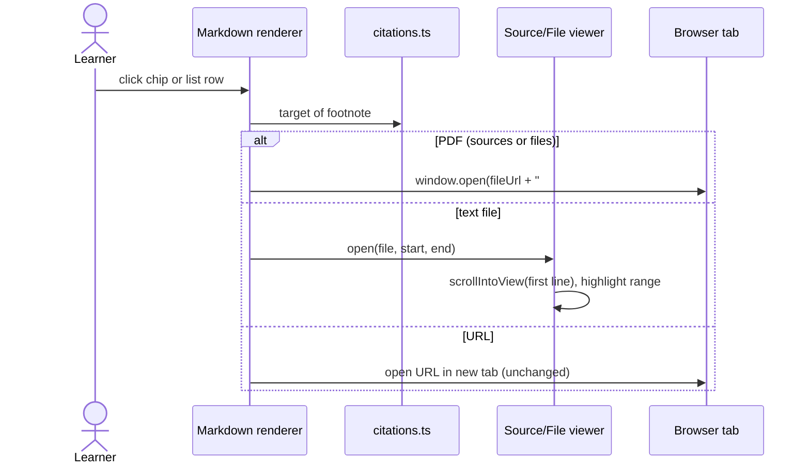

# Open cited sources and files from citations

## Now
1. Developer: run `/feature:plan server clickable-citations` (1 session, ~15 min).
2. Developer: run `/feature:plan web clickable-citations`, then `/feature:plan demo clickable-citations`.

## Short
- Every citation that names a file opens that file; today only URLs and exact `sources/<file>:<lines>` refs work.
- A footnote with commentary after the ref (`sources/a.pdf:1-4 (cover)`) is parsed as a source ref plus a comment, shown next to the link.
- PDFs open in a new browser tab at the cited page (`#page=N`), because the agent reads PDFs by page.
- Text sources open in the in-app viewer scrolled to the cited lines with the range highlighted (already works for `.md`/`.txt`, keep it).
- User-file citations (`files/<name>:a-b`, `<node id>/files/<name>:a-b`) become clickable with the same behaviour.

## Summary
Answers end with a numbered source list and inline citation chips. The list item in the screenshot,
`sources/desiging-data-intesive-applications.pdf:1-4 (страницы PDF: обложка и выходные данные)`,
renders as inert text: the citation parser (`web/src/lib/citations.ts`, `SOURCE_RE`) accepts a
ref only when the whole footnote is the ref. Even when a PDF ref parses, the viewer shows the PDF
in an iframe without jumping to the page. Citations of user files are never recognised.

This feature makes every file citation open the right file at the cited place, in one click.

## Goals
1. Parse a footnote whose ref is followed by free text: ref + comment. Comment is displayed muted next to the link.
2. Clicking a PDF citation opens the PDF in a new tab positioned at the first cited page.
3. Clicking a text citation (`.md`, `.txt`, e-book text) opens the in-app viewer scrolled to the first cited line, range highlighted.
4. User-file citations (`files/<name>:a-b` for the answer's own node, `<node id>/files/<name>:a-b` for earlier nodes) open the same way.
5. The system prompt tells the agent to cite PDF pages as `sources/<file>.pdf:<page>-<page>` and to put commentary after the ref.

## Non-goals
- Extracting PDF text into `<name>.pdf.md` (decided: open the original PDF instead).
- A custom in-app PDF viewer (pdf.js) or text highlighting inside PDFs.
- Scrolling web pages to the quoted passage for URL citations.
- Changing the footnote syntax or the citation numbering.

## Actors
- Learner: reads an answer, clicks a citation chip or a source-list row.
- Agent (Claude via SDK): writes footnotes; its prompt is adjusted so refs stay machine-readable.
- Server: serves source and user files; owns the prompt text.
- Demo: must mirror the web behaviour on its mock backend.

## Main scenarios

1. Source list row `sources/book.pdf:5-12 (contents)`: row shows badge `pdf`, file, "pages 5–12", muted comment. Click opens `/api/trees/<tree>/sources/book.pdf#page=5` in a new tab.
2. Inline chip `[2]` for the same footnote: same action as the row.
3. Row `sources/notes.md:120-134`: click opens the in-app viewer, line 120 scrolled into view, lines 120–134 highlighted (existing behaviour, now also from the list after the parser fix).
4. Row `files/report.pdf:3` in a saved answer: opens the node's user file at page 3 in a new tab. `ownership/intro/files/report.pdf:3` resolves to that node.
5. Row `files/draft.md:10-12`: opens the user file in the in-app text viewer scrolled to line 10, range highlighted.

## Edge cases
- Footnote is `sources/a.pdf:1-4 (comment)`, `` `sources/a.pdf:1-4` — comment``, or `[label](sources/a.pdf:1-4) comment`: all three yield ref + comment. Ref must be at the start; text with a ref in the middle stays `text`.
- Ref without a range (`sources/a.pdf`): PDF opens on page 1 (no fragment); text opens unscrolled.
- Page/line beyond the file: native viewer clamps pages; text viewer shows the file without highlight.
- E-book citation (`sources/book.epub:…` or `book.epub.md:…`): opens the extracted text as today.
- User-file citation in a still-streaming answer: the node does not exist yet, so the item renders as plain text until the answer is saved. After save, the renderer resolves `files/<name>` against the answer's node id.
- Cited user file is missing (node deleted or restored under another name): viewer shows its usual not-found error; PDF tab shows the server 404.
- Browser ignores `#page=` (Safari): the PDF still opens in a new tab on page 1. No workaround in scope.
- Pop-up blocking: open with a user-gesture `window.open`/anchor `target=_blank`, never from async code.
- Labels on the row and in the viewer header say "pages" for PDFs and "lines" for text, in both locales.

## Constraints (NFR)
- No server API change expected; existing `GET /trees/:tree/sources/:file` and `GET /trees/:tree/files?node=&name=` are reused. If the planner finds an API change necessary, the server owns the contract.
- Demo keeps parity: its mock `sourceUrl`/`userFileUrl` are blob URLs; `#page=` on a blob URL works in Chromium.
- Pure parsing stays in `web/src/lib/citations.ts` with tests; components stay thin.
- Display text is cut by graphemes, ids shown with `IdPath`, labels with `dir="auto"` (project rules).
- Run `pnpm check` for formatting; no hand formatting.

## Future considerations (out of scope)
- Text fragments (`#:~:text=`) for URL citations to land on the quoted passage.
- In-app PDF viewer (pdf.js) with page navigation and text highlight, same in every browser.
- Highlighting the exact quoted fragment inside a text source instead of whole lines.
- PDF text extraction to `<name>.pdf.md` like e-books, enabling line-level citations and Grep.
Keep `CitationTarget` open to a `fragment`/`quote` field and keep "open target" logic in one place so these can plug in.

## Open questions
- None blocking. Whether the comment in a footnote should also appear in the chip tooltip is a planner call (default: yes).

## Next
Developer: run `/feature:plan server clickable-citations`.
