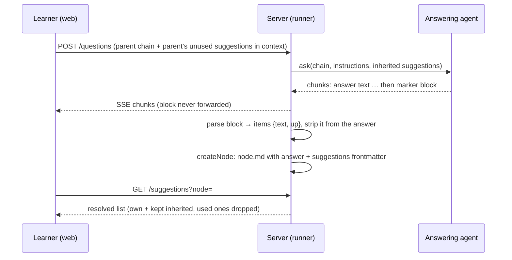

# Inline suggestions: the answering agent predicts the next question

## Now
1. Developer: run `/feature:research server inline-suggestions` (optional) or `/feature:plan server inline-suggestions`. Do it before the web and demo plans: the server owns the contract.
2. Developer: commit or drop the uncommitted `oneShotOptions` change in `server/src/agent/claude-agent.ts` before the plan starts. Naming still needs it; the suggest call it also covers goes away.

## Short
- No separate suggestion generator: the agent that writes the answer may end it with a marker block of predicted next questions.
- The server cuts the block out of the answer and stores the items in `node.md` frontmatter (`suggestions: [...]`, same format as today).
- The agent sees the ancestors' still-unused suggestions and decides which to keep. A kept item still points at its owner (`up: k`), so clicking it creates the node under that ancestor.
- Only the most obvious next steps (next chapter, second part of a long chapter). The prompt sets no count and the server sets no cap.
- Lazy generation (`POST /suggestions`), `agent.suggest`, the `Suggestions` service and `OTAGO_SUGGEST_MODEL` are removed. Old nodes keep working.

## Summary
Today a second model call (`agent.suggest`, Haiku) runs after every answer, and again lazily when a node without a list is opened. It produces up to 5 follow-up questions. This feature removes that generator. The main answering agent already reads the whole parent chain, so it knows what has been asked and answered. When it sees an obvious next step, it appends a marker block with predicted questions. The server parses the block at save time, removes it from the stored answer and writes the items into the node's frontmatter. Inheritance from ancestors and the click behavior stay as they are.

## Goals
- One model call per answer: suggestions come from the answering agent, not from a separate generator.
- Suggestions are rare and obvious: next chapter, second part of the current long chapter, and similar.
- The agent decides about inherited suggestions with full context: it keeps the ones still relevant and drops the rest.
- The stored format (`suggestions` frontmatter key, items `{ text, up }`) and `GET /trees/:tree/suggestions` keep working for existing trees.
- Users never see the marker block, neither while the answer streams nor in the saved answer.

## Non-goals
- No regeneration on demand for old nodes ("suggest more").
- No user editing, hiding or reordering of suggestions.
- No suggestion kinds, icons or ranking beyond the agent's order (own first).
- No change to how a click sends a question (`askSuggestion`, target, side-panel anchor rule).

## Actors
- Learner: reads the answer and clicks a suggestion to ask it.
- Answering agent (`claude-agent.ts` `ask`): writes the answer and optionally the suggestion block.
- Server: strips and parses the block, stores the items with the node, resolves the visible list on read.
- Web and demo clients: render the resolved list; the demo mock simulates the agent's block.

## Main scenarios

### S1. Answer with an obvious next step
The learner finishes chapter 3. The agent answers and ends with a block offering "Перейти к главе 4". The saved node stores `{ text: "Перейти к главе 4", up: 0 }`, and the button shows under the answer.

### S2. Clarifying question below a node with suggestions
The parent offers "Перейти к главе 4", and the learner asks a side question about a term. The agent sees the parent's unused suggestion and keeps it. The child stores it with `up: 1`. Clicking it on the child creates the node under the parent.

### S3. No obvious next step
The agent writes no block. The node gets no own list, and the visible list falls back to inheritance (see E1).

### S4. A suggestion was already asked
The learner asked "Перейти к главе 4" by hand under the parent. The existing "used" rule hides it everywhere it is inherited, and the agent no longer gets it as a candidate.

## Edge cases

### Block parsing
- E1. No block, or a block that does not parse: the text is kept without the block (if one was found), the node is saved with no `suggestions` key, and a warning is logged. On read, a node without a list shows the resolved list of its nearest ancestor with a stored list. Legacy nodes behave the same way.
- E2. Empty block, given on purpose: stored as `suggestions: []`. The agent dropped everything, and inheritance stops here, as for a stored empty list today.
- E3. Only a block at the very end of the answer counts. Marker-like text earlier, for example inside a code block about Otago itself, stays part of the answer.
- E4. Item texts go through the existing sanitizer (one line, NFC, ≤ 200 graphemes, wrapping quotes stripped). Empty, duplicate and already-asked items are dropped. The count is not capped.
- E5. Inherited items: a keep must reference a candidate the agent was given, so text and owner are verified. An unknown reference becomes a new own item if it has text, and is dropped otherwise.

### Lifecycle
- E6. Cancel, failure or attempt timeout (also mid-block): the node is not created, so nothing is stored. A retry is a new attempt with its own block.
- E7. Streaming: from the marker on, the server withholds the text from `chunk` events and from the registry text that snapshots send. A reconnecting client never sees a partial block.
- E8. Moves, deletes and renames of ancestors: `up` stays relative, as today. Resolution on read drops items whose owner no longer owns the text.

### Compatibility
- E9. Existing stored lists, including ones made by the old generator, are read as they are. Nothing is migrated or rewritten.
- E10. `POST /trees/:tree/suggestions` is removed. GET never returns `missing` for a node that inherits (E1); the plan decides whether the `missing` state stays in the response at all. Web and demo ship in the same change, because the app is local only.
- E11. A leftover `OTAGO_SUGGEST_MODEL` in `server/.env` is ignored.
- E12. Suggestion writes never take a tree lock and never cause a 409. They are part of `createNode` now, so no separate write exists.

## Constraints (NFR)
- No extra model calls or latency per answer: the block is part of the same streamed reply.
- The prompt says: only the most obvious next steps, in the language and script of the answer, often none. It names no number.
- Parsing is pure and Node-free if the demo mock is to reuse it, like `server/src/storage/suggestions.ts` today.
- `node.md` keeps one exchange; the frontmatter format is unchanged (`suggestions: <json>` single line).
- Tests use `fakeAgent()` with scripted chunks that include a block; no real SDK calls.

## Future considerations (out of scope)
None requested. Keep the stored item shape open to extra fields without a format break, as today.

## Open questions
1. Marker syntax: an HTML comment pair like `<!-- otago:suggestions -->` … with JSON or a list inside. It must be cheap to detect while streaming. Decide in the server plan / contract.
2. How inherited candidates reach the agent: a section of the system prompt or of the chain context, and keep by number or by verbatim text. Decide in the server plan.
3. Whether GET keeps the `missing` state (E10) and how the web handles it without the lazy POST. Decide in the contract.
4. Whether `pnpm --filter @otago/server ask` prints the parsed suggestions. Decide in the server plan.

## Next
Run `/feature:plan server inline-suggestions`.
