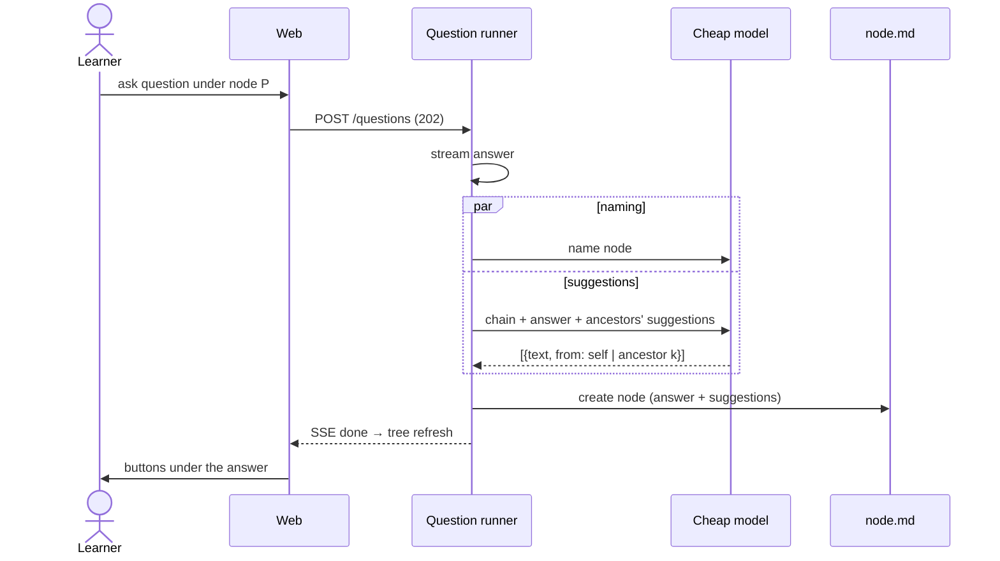
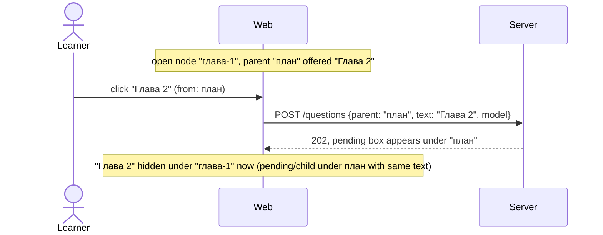
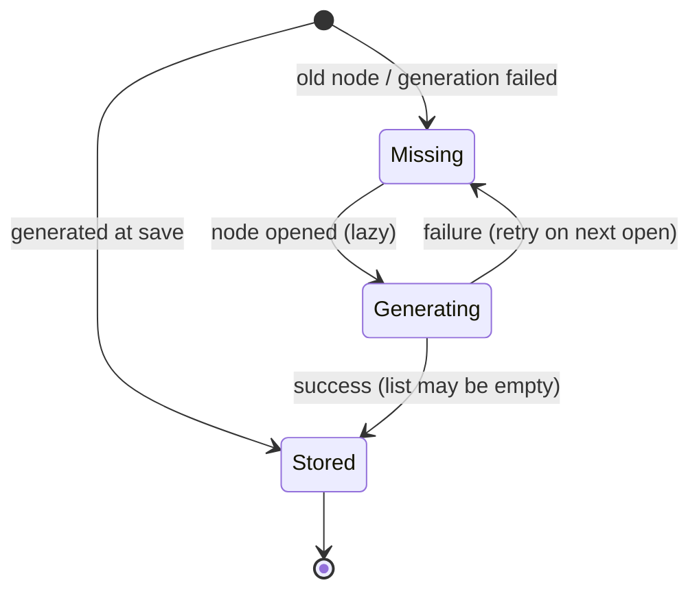

# Suggested follow-up prompts under a node's answer

## Now
1. Developer: optionally run `/feature:research server suggested-prompts` (~15 min).
2. Developer: run `/feature:plan server suggested-prompts` before web and demo; the server owns the contract.

## Short
- Under a node's answer the chat shows 0–5 buttons. Each button holds one obvious next question, such as "Перейдём к главе 2".
- Clicking a button sends that text as a normal user question at once, as if the learner had typed it.
- Suggestions are inherited. A suggestion offered by an ancestor is shown under a descendant when it still makes sense there. Clicking it asks the question **from the ancestor that offered it**, so "Глава 2" becomes a sibling of "Глава 1".
- Suggestions are generated by a separate cheap model call when an answer is saved, and stored in `node.md`. Old nodes get theirs lazily, on first open.
- A suggestion is hidden once the node it targets already has a child, or an in-flight question, with the same question text.

## Summary
Learning in Otago often follows a plan that Claude states in an answer: "start with chapter 1, then 2 and 3", or "next we can cover X". Today the learner has to retype that continuation by hand. This feature turns such obvious continuations into one-click prompts at the end of the node's chat.

Suggestions take the chain into account. If the parent said "chapter 1 first, then 2 and 3" and the current node is chapter 1, the learner sees follow-ups about chapter 1 (own suggestions) and also "chapter 2" and "chapter 3" (inherited from the parent, asked from the parent).

## Goals
1. After an answer is saved, generate up to 5 suggestions for the node. Each suggestion is a full question text in the answer's language, plus the node it should be asked from: the node itself or one of its ancestors.
2. Generation sees the chain (questions and answers) and the ancestors' stored suggestions. It keeps an inherited suggestion only if it still makes sense in the current node's context.
3. Generation returns nothing when there is no obvious continuation. Zero suggestions is a valid, stored result.
4. Show suggestions as buttons at the end of the node's chat, in the main panel and in the side (ask-aside) panel. Each button shows the prompt text, with inherited ones visibly marked by their source.
5. A click sends the prompt through the normal questions flow (`POST /trees/:tree/questions`) to the target node. It uses the panel's selected model, no files, and leaves the composer draft untouched.
6. Old nodes (no stored suggestions) get suggestions generated on first open and persisted to `node.md`.

## Non-goals
- The main answering agent does not write suggestions into the answer text.
- No click tracking or "used" flag stored in files. Hiding is derived from children.
- No user editing of suggestions, no regenerate button, no per-tree on/off setting.
- No suggestions while an answer is still streaming. They appear once the node is saved.

## Actors
- Learner: reads an answer and clicks a suggestion button.
- Server: generates, stores and serves suggestions. It owns the generation prompt and the contract.
- Naming-class model (cheap): produces the suggestion list from the chain.
- Web: renders the buttons, decides visibility (hides used ones), sends the question, and triggers lazy generation for old nodes.
- Demo: mirrors the behaviour on the mock backend (simulated suggestions, lazy path included).

## Main scenarios

### A. New answer gets suggestions

### B. Click an inherited suggestion

### C. Old node, lazy generation
1. The learner opens a node whose `node.md` has no suggestions field.
2. Web requests generation for that node. Server generates and persists the list, then returns it.
3. Buttons appear. Later opens read the stored list; nothing is regenerated.

### Suggestion lifecycle (per node)

## Edge cases

### Generation and storage
- **Generation fails or times out at save.** The answer is still saved; suggestions stay *missing*, never an empty list, so lazy generation retries on next open. It must not fail or delay the question beyond naming time: run it in parallel with naming.
- **Missing vs empty.** "Not generated yet" (field absent) and "generated, nothing obvious" (`[]`) must be distinguishable in `node.md`, so old nodes and failures retry while empty results don't.
- **Malformed model output.** Unparseable output becomes a failure (stays missing). Invalid items are dropped. Text is trimmed, deduplicated, length-capped and capped at 5 items.
- **Language.** Suggestions use the answer's language, like naming.

### Inheritance and tree edits
- **Reference to the source node.** A stored inherited suggestion must survive renames of the node and its ancestors (ids change). Store it relative to the node (e.g. "k levels up"), not as an absolute node id.
- **Node moved to another parent.** Relative references may now point at a different ancestor. On read, an inherited suggestion is shown only if the resolved ancestor's own stored suggestions still contain the same text; otherwise it is dropped silently.
- **Ancestor deleted (soft) or restored.** Resolution follows the live tree. A suggestion whose source no longer resolves is not shown.
- **Ancestor without suggestions (old node).** Inheritance just skips it. Lazy generation of the current node does not force generation of its ancestors.

### Lazy generation for old nodes
- **Concurrent opens** (two tabs, double render) for the same node must trigger one generation, not two (in-memory dedup per node).
- **Must not block structural edits.** Move/delete/restore/rename/title change must not get a 409 because a background suggestion generation is running. If the node moved or was deleted meanwhile, the result is discarded (or written to the node's new location). It must never recreate a deleted folder.
- **Must not race the node's other writers.** Writing suggestions into `node.md` is atomic and preserves the rest of the file (frontmatter, user and assistant text) byte-for-byte.
- **Cost bound.** Generation happens only for a node the learner actually opens, once per node until it succeeds. No bulk backfill.

### Clicking and visibility
- **Hide used suggestions.** Hide a suggestion if its target node already has a child whose question text equals the suggestion (trimmed, NFC), or an in-flight question with that text under that target.
- **Double click.** It must send at most one question (button disabled while the send is pending).
- **Tree busy.** Questions take the shared lock, so a click normally succeeds. If the send fails before 202, show the usual error notice; nothing goes into the composer.
- **Root node / tree root.** A suggestion from the topmost node targets that node; there is no "ask from tree root" case unless the target is the root node itself.
- **Duplicates across levels.** If own and inherited suggestions have the same text, show one: the own one wins.
- **Side panel.** The side panel shows the suggestions of its own focused node, and clicks go to that panel's flow.

## Constraints (NFR)
- Filesystem stays the source of truth. Suggestions live in `node.md` (frontmatter); no database, no separate index.
- Existing `node.md` files without the field stay valid (backward compatible parse); serialization round-trips unchanged nodes.
- Generation uses the cheap model class (same as naming, `OTAGO_NAMING_MODEL` or a dedicated env var; decided in plan). No tools, no file access.
- Tests use `fakeAgent()` scripting; no real SDK calls. The `Agent` interface grows a suggestions method next to `name`.
- The web never subscribes to stream text for this. Suggestions come from the tree/node query after save.
- The demo mock mirrors the contract (CLAUDE.md: when the server contract changes, update the mock).
- Display text is cut by graphemes (`lib/text.ts`), labels use `dir="auto"`.

## Future considerations (out of scope)
None requested. Keep the stored item shape open to extra fields (e.g. a kind or id) without a format break.

## Open questions
1. The exact cap split: own vs inherited (proposed: at most 5 total, own first). Decide in plan.
2. The model env var: reuse `OTAGO_NAMING_MODEL` or add `OTAGO_SUGGEST_MODEL` defaulting to it. Decide in plan.
3. The lazy endpoint shape and how the web learns "missing" vs "empty" (node payload field vs separate route). Decide in the server plan / contract.

## Next
Run `/feature:plan server suggested-prompts`.
