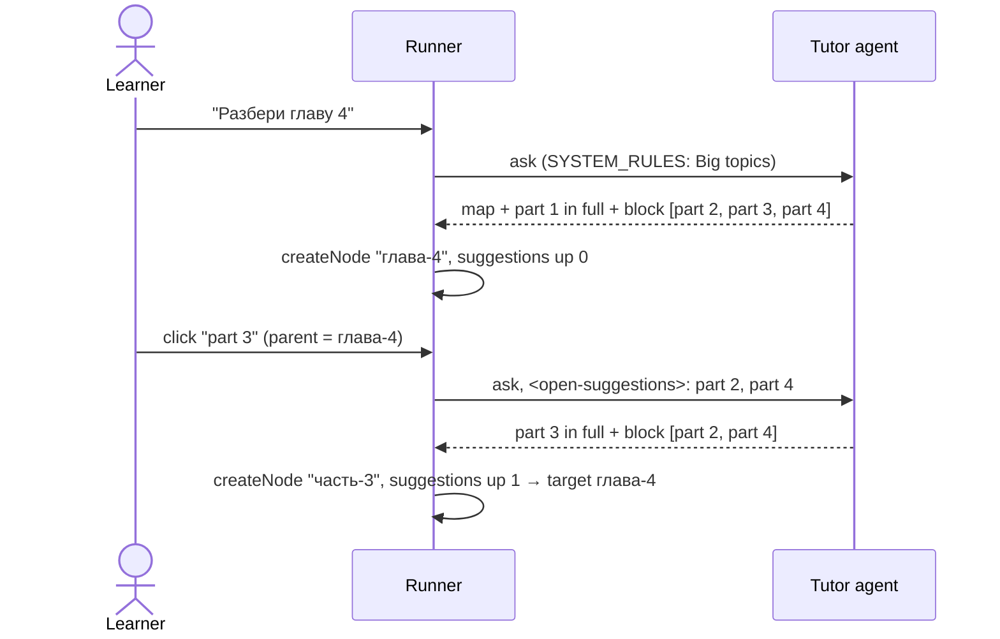

# Split a big topic: the first part now, the rest as next questions

## Now
1. Developer: ask a chapter-sized question with `pnpm --filter @otago/server ask <tree> "Разбери главу 4"` and check that the answer shows the map, explains part one and prints the remaining parts under `--- suggestions block:` (~5 min).
2. Developer: run `/feature:archive topic-split` once it behaves well on real trees.

## Short
- Prompt-only feature: a "Big topics" section in `SYSTEM_RULES` (`server/src/agent/prompt.ts`). No tool, no new frontmatter key, no API, web or demo change.
- A question too big for one answer gets a short map of its parts, then only the first part in full detail.
- The remaining parts go into the inline-suggestions block (`<!-- otago:suggestions -->`), one request per part, in map order.
- A click asks a part under the map node. Below it, the uncovered parts come back as `<open-suggestions>`; the agent copies them into its block word for word, or writes no block and they stay by inheritance.
- A part that is still too big is split again; "short overview" / "everything in one answer" requests are not split.

## Summary
The tutor already did this on its own: it saw a chapter of four parts, explained the first and said the others come next. This feature makes that behavior a rule. It replaces the earlier design (a `propose_subtopics` tool, a `subtopics` frontmatter key, a merge with the old suggestion generator). That design became unnecessary with `inline-suggestions`: the answering agent already writes the next questions itself, and the server already stores, inherits, targets and hides them.

## How it flows



All parts end up as siblings under the map node:

```
глава-4      (map + part 1; buttons: part 2, part 3, part 4)
├── часть-3  (buttons: part 2, part 4 → asked from глава-4)
├── часть-2
└── часть-4
```

## Rules in the prompt
- Split only when the question covers more than one answer can explain in full detail.
- Map first (one line per part, order, "first part now, the others next"), then part one only.
- Block: one request per remaining part, map order, each understandable on its own, in the answer's language.
- Answering a part: explain it in full; keep the still-uncovered parts from `<open-suggestions>` word for word.
- Split a part again when it is still too big. No split for an explicit short or single answer.
- No numbers in the section (same rule as "Next questions").

## Edge cases
- **Agent writes no block on a part**: the uncovered parts stay visible through inheritance (inline-suggestions E1).
- **Agent writes a block but forgets the parts**: they are dropped from that node down. Mitigated by the rule; not enforced by the server.
- **Order of buttons on a part node**: own new items are stored before kept ones (`finalizeSuggestions`), so an own extra question shows before the remaining parts.
- **Part asked by hand under the map node**: the "used" rule hides the matching button.

## Tests
- `server/test/agent.test.ts` "splits a big topic…": section present before "Next questions", key phrases, no digits.

## Next
Run step 1 of "Now" on a tree with a long chapter in `sources/`.
