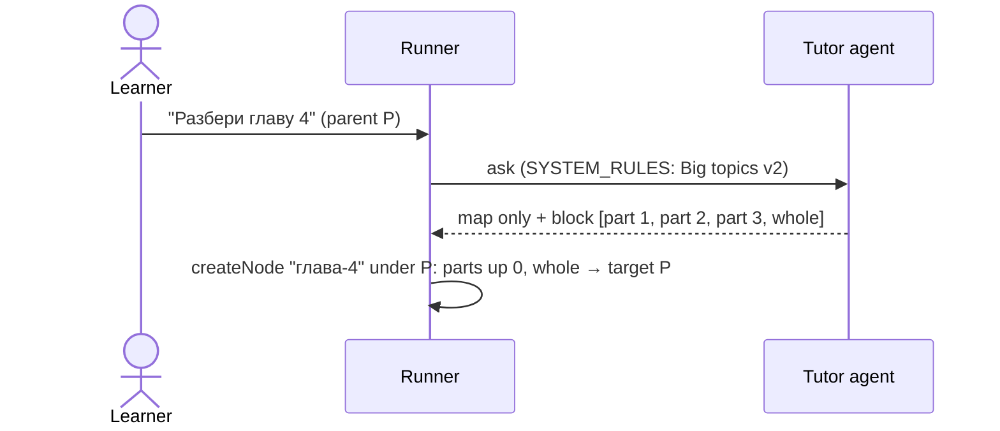

# Topic split v2: map only, every part a button, plus "explain it whole"

## Now
1. Developer: run `/feature:research server topic-split-v2` (optional, ~10 min), or go straight to `/feature:plan server topic-split-v2`.
2. Developer: answer the open questions at the end of this file before planning the web side (~5 min).

## Short
- A split answer no longer explains part one. It says the topic is big, lists its parts (the map) and stops.
- Every part, the first included, becomes a suggestion button on the map node, in map order.
- A split answer also gets one special button, "explain it whole". It shows only when the agent split, and only on the map node.
- Clicking it asks the original topic again in one answer. The new node is a sibling of the map node (child of the map node's parent). The panel focus moves to it at once.
- Mostly a prompt change, but the special button needs a small contract change: a marked block item, a stored item kind, a target one level up, no inheritance.

## Summary
Today (`topic-split`, archived 15-10-2026) a question too big for one answer gets a map, then part one in full, and parts 2..N go to the suggestion block. Now the map answer explains nothing: the learner picks any part from the buttons, the first part included.

Some learners still want the whole topic at once. For them the map node offers "explain it whole". Its text is written by the agent in the answer's language (for example "Объясни главу 4 целиком, без разбиения") and becomes the question of the new node. The existing rule "asked for everything in one answer → do not split" makes the agent answer in full.

## Goals
- Map answers contain only the map: a short statement that the topic is big and the list of parts.
- All parts are buttons on the map node; parts asked from there land as children of the map node (as now).
- "Explain it whole" appears exactly when the agent split, on the map node only.
- Its click creates a node under the map node's parent and focuses that node's panel immediately.

## Non-goals
- No change to how a part answer keeps the still-uncovered parts (`<open-suggestions>`, copied word for word).
- No auto-delete or replace of the map node after "explain it whole". Both nodes stay; the learner can delete the map (with Ctrl+Z).
- No transfer of the original question's user files to the "whole" node.
- No migration of nodes saved with the v1 behavior.

## Actors
- **Learner**: asks a big question, picks a part or "explain it whole".
- **Tutor agent**: decides to split, writes the map, the part requests and the "whole" request.
- **Server runner**: parses the block, stores the special item with its kind and target.
- **Web / demo**: render the special button, send it to the right target, move focus.

## Main scenarios

### S1. Split into a map


### S2. Pick a part
Click "part 1" on `глава-4` → node `часть-1` under `глава-4`. Its answer explains part 1 in full and keeps parts 2 and 3 from `<open-suggestions>`. "Explain it whole" is not offered there (not inherited, not a candidate).

### S3. Explain it whole
```
P
├── глава-4        (map; buttons: part 1, part 2, part 3, explain it whole)
│   └── часть-1
└── глава-4-целиком   ← created by "explain it whole", focus moves here
```
The click sends the agent-written "whole" text to P. The panel switches to the in-flight question right away and follows it to the saved node.

## Edge cases

### Placement and focus
- **Map node is top-level**: its parent is the tree root; the "whole" node is a new top-level node.
- **Map node shown in the side panel**: focus moves within that same panel.
- **Map node moved or renamed**: the target is relative (one level up), so it follows the move.
- **Nested split** (a part split again): that part is the new map; its "whole" button targets the outer map node.
- **Tree busy** (move/delete/rename running): the normal 409 `tree_busy_streaming` path and blockers dialog.

### Agent output
- **Split without a "whole" item**: no special button. Mitigated by the prompt rule; server does not invent one (it cannot localize the text).
- **"Whole" item without a split**: [TBD: accept, or keep only when the block also has ≥ 2 part items].
- **More than one "whole" item**: keep the first, drop the rest.
- **"Whole" answer still too big**: the explicit "in one answer" request disables splitting (existing rule).

### Buttons and state
- **Clicked twice / asked by hand under P**: the existing "used" rule (same target + `suggestionKey`) hides the button.
- **Part node without its own block**: inherits the map's parts but not "explain it whole".
- **Old v1 map nodes** (part one already explained): stay as they are; no special button.

## Constraints (NFR)
- Server owns the contract (`.claude/features/topic-split-v2/contracts/`); web and demo follow it.
- Backward compatible storage: a new optional key on stored items (readers already ignore unknown item keys); old nodes parse unchanged.
- Chunks and `live.answer` still never contain the block, including the special item.
- `storage/suggestions.ts` and `storage/suggestion-block.ts` stay pure and Node-free (the demo imports them).
- The prompt section keeps the "no numbers" rule of the current "Big topics" section; the agent test checks the new phrases.

## Future considerations (out of scope)
None given. The stored item kind is still the natural place for other special buttons later.

## Open questions
1. Block grammar for the special item: a prefix on the item line or a second marker line? (plan, server)
2. Look of the button: distinct style, placed last in the list? (web)
3. Does the current `askSuggestion` focus a question sent to an ancestor target, or is this new web behavior? (research, web)
4. "Whole" item without a split: accept or drop? (see Edge cases)

## Next
Run `/feature:plan server topic-split-v2`.
