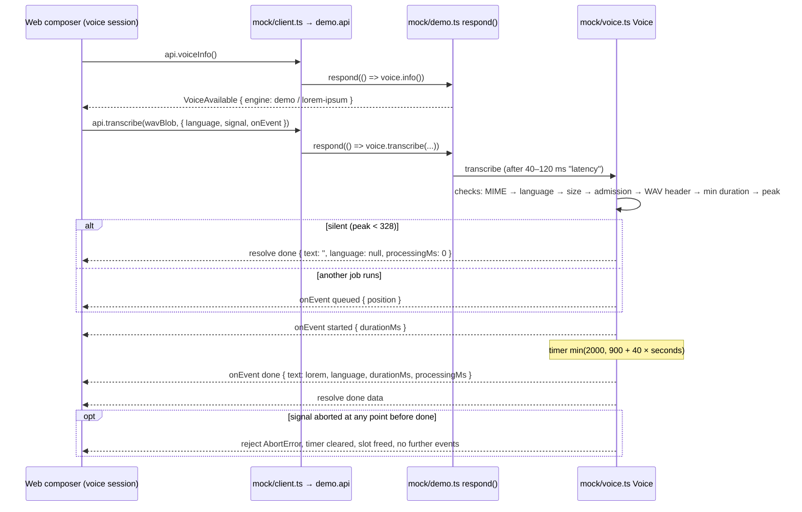
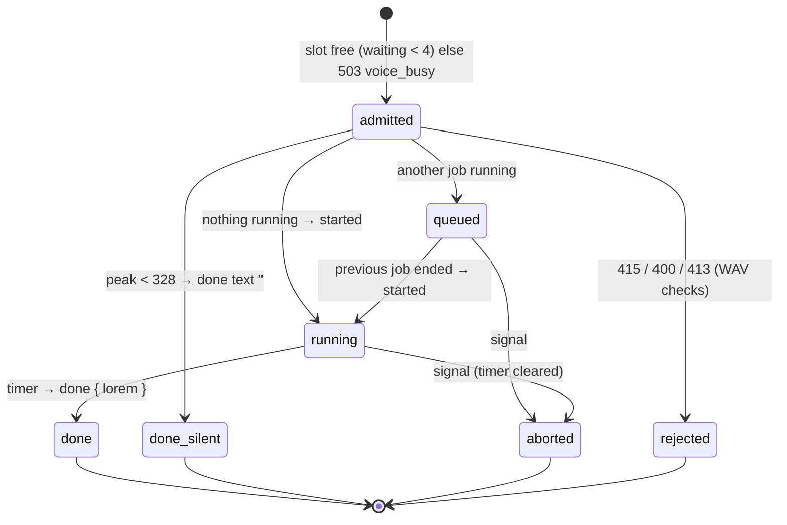

# Plan: voice-input, project `demo`

Stage 3 (plan), client role. Binding for `/feature:implement demo`. Planned strictly against
`.claude/features/voice-input/contracts/` (`voice-api.ts` "Demo mock obligations", `audio.ts`,
`voice-events.ts`, `errors.ts`). The contract wins over this plan; the web plan
(`projects/web/plan.md`, not written yet) wins over this plan for client-side names and signatures.

## Now

1. **Web planner** (`/feature:plan web`): fix the client surface in `projects/web/plan.md` —
   `api.voiceInfo()` / `api.transcribe(blob, { language, signal, onEvent })` as members of `api`,
   the abort error type, and where `VoiceInfo` / `TranscriptionStreamEvent` / `VoiceErrorCode`
   live in `web/src/api/types.ts`. Deadline: before `/feature:implement demo` starts (target
   2026-10-15).
2. **Demo implementer** (`/feature:implement demo`): implement this plan only after the web's
   `client.ts` + `types.ts` changes exist in the checkout, then run
   `pnpm --filter @otago/demo lint` first — `exportsComplete` and `DemoApi = typeof realApi` list
   every missing export. Budget: 3.5 h, one working day after the web lands.

## Short

- The demo mocks only the server: a new `demo/src/mock/voice.ts` (`Voice` class, like
  `questions.ts`) answers `voiceInfo()` with `engine: { name: 'demo', model: 'lorem-ipsum' }` and
  "transcribes" a WAV blob to plain Lorem ipsum after 0.9–2 s, 2.5 words per second of audio.
- Recording, WAV encoding, the mic button, the language switcher and every UI state are web
  code shared unchanged by the demo; they are out of this plan's scope.
- Validation mirrors the server order where it is cheap: 415 wrong MIME/layout, 400 `Invalid
  input` for a bad language, 413 above `maxBytes`, 503 `voice_busy`, 400 `invalid_audio` /
  `empty_audio`, silence (peak < 328) → `done { text: '' }` without `queued`/`started`.
- One job runs at a time, at most 4 wait (`queued { position }`), abort = the `AbortSignal`
  (reject with `AbortError`, no event after it). Audio is never stored (no VFS, no localStorage).
- Open until the web plan exists: exact member names/signatures and the event-delivery shape
  (`onEvent` callback is assumed; a `Response`-based fallback is described).

## Scope split

The demo owns the mock server only. Everything the user sees is the web UI running on top of the
mock, so a bug in recording or insertion is a web bug even when found in the demo.

| Concern | Owner | In this plan |
|---|---|---|
| Mic permission, `getUserMedia`, AudioWorklet capture, 16 kHz WAV encoding | web | no |
| Mic button, shortcut, language switcher, notices, insertion at caret | web | no |
| `GET /api/voice` and `POST /api/voice/transcriptions` semantics in the browser | demo | yes |
| Shim exports (`demo/src/mock/client.ts`) matching `web/src/api/client.ts` | demo | yes |
| Seed trees (`demo/seed/`) | demo | no change needed |

## Request sequence



## Mock job state machine



`queued` positions are re-emitted to the remaining waiters whenever one leaves (done or abort),
strictly decreasing, as the contract requires.

## Files

### New

| Path | Purpose | Est. |
|---|---|---|
| `demo/src/mock/voice.ts` | `Voice` class: `info()`, `transcribe()`, queue of 1 running + ≤ 4 waiting, timers via `Schedule`, abort handling, lorem transcript | 60 min |
| `demo/src/mock/wav.ts` | Pure `inspectWav(bytes)`: RIFF chunk walk per `audio.ts` rules → `{ dataBytes, durationMs, peak }` or a typed rejection | 40 min |
| `demo/src/mock/voice.test.ts` | Vitest cases listed under "Test plan" | 45 min |
| `demo/src/mock/wav.test.ts` | Header/layout/peak cases of the inspector | 20 min |

### Changed

| Path | Change | Est. |
|---|---|---|
| `demo/src/mock/lorem.ts` | Add `loremSpeech(random, words)`: plain sentences, no markdown, no lists | 15 min |
| `demo/src/mock/errors.ts` | Add `unsupportedMediaType(message, code, details?)` (415) and `serviceUnavailable(message, code, details?)` (503) | 5 min |
| `demo/src/mock/demo.ts` | `DemoOptions.voice?`, `Demo.voice`, `api.voiceInfo` / `api.transcribe` wired through `respond()` | 15 min |
| `demo/src/mock/test-helpers.ts` | `wavBlob({ seconds, amplitude, sampleRate?, channels?, bits? })` synthetic WAV encoder for tests | 15 min |
| `demo/src/DemoBanner.tsx`, `README.md` | Banner note mentions simulated dictation; README demo bullet | 10 min |

`demo/src/mock/client.ts` changes only if the web adds top-level exports beyond `api` (the guard
tells). `demo/vercel.json`, `demo/vite.config.ts`, `demo/src/main.tsx`, `demo/seed/` are
untouched. Total ≈ 3.5 h plus 15 min manual check in the browser.

## Decisions

### D1 — Where the behaviour lives

`demo/src/mock/voice.ts` holds all voice semantics in one `Voice` class, mirroring how
`questions.ts` bundles registry + runner + service. `demo.ts` only adds the two `api` members and
the shared `respond()` latency. The class takes `schedule`, `random`, `now` like `Questions`, so
tests drive it with fake timers through `makeDemo()`.

### D2 — WAV inspection: own parser, not the server's

The demo writes its own `wav.ts` (~80 lines) instead of importing the planned
`server/src/storage/wav.ts`: the server inspector throws server `AppError`s and is incremental
(stream-oriented), while the demo has the whole blob and needs `ApiError`s. Rules copied from
`audio.ts`: `RIFF`/`WAVE`, skip unknown chunks (even-padded), `fmt ` before `data`, PCM 1 /
mono / 16 000 Hz / 16-bit with blockAlign 2 and byteRate 32 000, `data` size even, not
`0xFFFFFFFF`, fully present, ≤ 64 KiB before the payload.

Outcomes: not RIFF/WAVE, truncated or missing chunks → 400 `invalid_audio`; well-formed WAV with
another layout → 415 `unsupported_audio_format` with `details: { audioFormat, channels,
sampleRate, bitsPerSample }`; `dataBytes < 3 200` or empty blob → 400 `empty_audio`. Duration
= `Math.round(dataBytes / 32)` ms.

### D3 — Silence rule: computed from the samples

The mock computes the absolute peak over all int16 samples with a `DataView` loop (little-endian;
no `Int16Array` on a possibly unaligned offset). 115 MB of audio is ~57 M samples, well under
100 ms in the browser, so the cost is acceptable. Peak < `VOICE_SILENCE_PEAK` (328) → resolve
`done { text: '', language: null, durationMs, processingMs: 0 }` right away, no `queued`, no
`started`, no queue slot used.

### D4 — Transcript text and language

`loremSpeech(random, words)` returns plain Latin Lorem ipsum sentences (6–16 words each,
capitalised, full stops, no bold/lists/commas) with `words = max(3, round(seconds × 2.5))`
(~150 wpm speech). The demo has no Russian word list, so `ru` also gets Latin Lorem ipsum;
`done.language` is the requested language, or `'en'` for `auto` (contract wording). A Russian
word list is an optional later touch, not needed for the UI flow.

### D5 — Timing

`processingMs = min(2 000, 900 + 40 × seconds)` (5 s audio → 1.1 s, 30 s+ → 2 s), so the
"transcribing…" state is visible but short, in the contract's ~1–2 s band. `started` is emitted
when the job begins (right after admission if nothing runs), `done` when the timer fires.
Events never fire synchronously inside the `transcribe` call: the first one comes after the
`respond()` latency, so the web's session state is already set up.

### D6 — Queue and `voice_busy`

One running job, `maxWaiting` = 4 (`DemoOptions.voice.maxWaiting`, default 4; `0` = refuse
every concurrent call). Admission happens before the bytes are read, like the server's step 5.
Full queue → 503 `voice_busy`, `details: { waiting, maxWaiting }` (no `Retry-After`: an
`ApiError` has no headers; the web must not depend on it). The queue is per page (the mock is
not shared between tabs); in the UI `queued` is reachable only when the side panel transcribes
while the main one does, and 503 is effectively test-only.

### D7 — Abort

`signal.throwIfAborted()` before any work; an `abort` listener on the signal removes the job
from `waiting` (re-emitting positions), or clears the running timer and starts the next job. The
promise rejects with `signal.reason` when set, else `new DOMException('The operation was
aborted.', 'AbortError')` — the same value `fetch` rejects with. Nothing is emitted after an
abort, and `onEvent` is never called for a settled job.

### D8 — Validation order (mirrors `voice-api.ts` steps 1–6)

| Step | Check | Rejection |
|---|---|---|
| 1 | always available | never `voice_unavailable` |
| 2 | `audio.type` (lower-cased, parameters stripped) ∈ `audio/wav`, `audio/x-wav`, `audio/wave` | 415 `unsupported_audio_format` (no details) |
| 3 | `language` ∈ `auto`/`en`/`ru` (default `auto`) | 400 `Invalid input` (no code) |
| 4 | `audio.size ≤ limits.maxBytes` | 413 `audio_too_large`, `details: { maxBytes }` |
| 5–6 | admission, then `await audio.arrayBuffer()` + `inspectWav` + min duration | 503 `voice_busy`; 400/415/400 from D2 |

`limits.maxBytes` = `0xFFFFFFFF` (contract `VOICE_DEFAULT_MAX_BYTES`): the demo stores nothing,
so the only cap is the WAV ceiling, and the 413 path is test-only.

### D9 — No simulated failures in v1

The mock never emits an in-stream `error`; the web's retry UI is covered by web tests. If a
visible "transcription failed → retry" demo is wanted later, add `DemoOptions.voice.failNext`
(one `transcription_failed` rejection as `ApiError(0, …)`), the same way `questions.ts` fails on
the word `fail`.

## Interface changes

### `demo/src/mock/voice.ts` (new)

```ts
export interface VoiceOptions {
  schedule?: Schedule;            // from questions.ts
  random?: () => number;
  now?: () => number;
  maxWaiting?: number;            // default 4
  processingMs?: (durationMs: number) => number; // default D5 formula
}
export class Voice {
  constructor(options?: VoiceOptions);
  info(): VoiceAvailable;         // engine { name: 'demo', model: 'lorem-ipsum' }, streaming: false
  transcribe(audio: Blob, options: {
    language?: VoiceLanguage; signal?: AbortSignal;
    onEvent?: (event: TranscriptionStreamEvent) => void;
  }): Promise<TranscriptionResult>;
  readonly waiting: number;       // tests
  readonly running: boolean;      // tests
}
```

Types (`VoiceAvailable`, `VoiceLanguage`, `TranscriptionStreamEvent`, `TranscriptionResult`)
are imported from `web/src/api/types.ts`, where the web plan mirrors the contract. Constants
(`328`, `100` ms, `32 000` B/s, `4`, `0xFFFFFFFF`) are taken from the web's exports if the web
plan exports them; otherwise they are local `const`s in `voice.ts` with a comment naming the
contract file.

### `demo/src/mock/demo.ts`

`DemoOptions` gains `voice?: Pick<VoiceOptions, 'maxWaiting' | 'processingMs'>`; `Demo` gains
`voice: Voice`; `api` gains `voiceInfo: () => respond(() => voice.info())` and
`transcribe: (audio, options) => respond(() => voice.transcribe(audio, options))`. `DemoApi` is
`typeof realApi`, so `tsc` fails until both members match the web's signatures exactly.

### `demo/src/mock/errors.ts`, `demo/src/mock/lorem.ts`, `demo/src/mock/test-helpers.ts`

`unsupportedMediaType` (415) and `serviceUnavailable` (503) builders beside the existing ones;
`loremSpeech(random, words): string`; `wavBlob(opts): Blob` that writes the canonical 44-byte
header and a sine (amplitude in int16 units, default 8 000) or silence (amplitude 0 or 100), with
overridable `sampleRate` / `channels` / `bits` / `audioFormat` to craft 415 cases, plus a
`type` override for the MIME case.

### `demo/src/mock/client.ts`

Unchanged unless the web adds top-level exports (e.g. a `VOICE_LANGUAGES` list, a URL helper, or
a type). The `exportsComplete` guard reports each missing name as a type error.

## Step ordering

### Before the web lands (no dependency)

1. `wav.ts` + `wav.test.ts` (pure, no dependency on the web) — 1 h.
2. `lorem.ts` `loremSpeech` + `errors.ts` builders — 20 min.

### After the web's `client.ts` / `types.ts` are in the checkout

3. `voice.ts` against the web's `types.ts` names — 1 h.
4. `demo.ts` wiring + `test-helpers.ts` `wavBlob` — 30 min.
5. `voice.test.ts`; `pnpm --filter @otago/demo test`, then `pnpm --filter @otago/demo lint`
   (`exportsComplete`, `DemoApi`) — 45 min.
6. Banner + README; manual check with `pnpm demo` (record 5 s → Lorem ipsum inserted; stay quiet
   5 s → "nothing recognized"; `Esc` while recording → nothing sent) — 25 min.

Run `pnpm check` (Biome) before finishing; never hand-format.

## Test plan (`demo/src/mock/voice.test.ts`, fake timers like `questions.test.ts`)

### Capability and happy path

| Case | Expectation |
|---|---|
| `voiceInfo()` shape | `available: true`, `languages` = `['auto','en','ru']`, `audio` = 16 kHz/1/16, `limits` = `{ maxBytes: 0xFFFFFFFF, minDurationMs: 100 }`, `streaming: false`, `engine: { name: 'demo', model: 'lorem-ipsum' }` |
| 5 s sine, `language: 'ru'` | events `started { durationMs: 5000 }` → `done`; `done.text` ≈ 12–13 words, no `*`/`-`; `language: 'ru'`; `durationMs: 5000`; `processingMs: 1100`; promise resolves with the `done` data |
| `language: 'auto'` | `done.language === 'en'` |
| longer audio → longer text | 20 s yields more words than 4 s (same `random`) |
| event ordering with two jobs | second call gets `queued { position: 1 }` → `started` → `done` only after the first `done`; first job sees no `queued` |

### Nothing recognized and abort

| Case | Expectation |
|---|---|
| silent 3 s (amplitude 100 < 328) | resolves `done { text: '', language: null, processingMs: 0 }` with no `queued`/`started`, no timer pending, slot free |
| 50 ms of audio, and a 0-byte blob | 400 `empty_audio` |
| abort while running | reject `AbortError`, no `done`, `running === false`, a job queued behind starts |
| abort while queued | reject `AbortError`; the job behind it receives a new `queued { position }` smaller than before |
| already-aborted signal | rejects before any event, nothing admitted |

### Rejections

| Case | Expectation |
|---|---|
| `type: 'audio/webm'` or `''` | 415 `unsupported_audio_format`, no `details` |
| 48 kHz stereo WAV | 415 `unsupported_audio_format`, `details.sampleRate === 48000`, `channels === 2` |
| garbage bytes with `audio/wav`; `data` size `0xFFFFFFFF`; `fmt ` after `data` | 400 `invalid_audio` |
| `language: 'de'` | 400 `Invalid input` |
| `voice: { maxWaiting: 0 }` + second call | 503 `voice_busy`, `details: { waiting: 0, maxWaiting: 0 }` |

Every rejection is an `ApiError` (`isApiError(error, status, code)`), checked with the test's
`rejection()` helper. The JSON `Accept` variant has no separate test: in the mock, `transcribe`
without `onEvent` is the blocking variant and is already covered by the happy path.

## Reconcile with `projects/web/plan.md` (before step 3)

### Names and types

1. `api.voiceInfo` / `api.transcribe` are members of `api` (not top-level exports) with the
   contract signatures; any difference breaks `DemoApi = typeof realApi` at `tsc`.
2. `web/src/api/types.ts` exports `VoiceInfo`, `VoiceAvailable`, `VoiceLanguage`,
   `TranscriptionStreamEvent`, `TranscriptionResult`, `VoiceErrorCode`; `ApiErrorCode` in
   `client.ts` includes `VoiceErrorCode` so `badRequest(…, 'invalid_audio')` type-checks.
3. Whether the web exports the contract constants (`VOICE_SILENCE_PEAK` etc.) — if yes, import
   them instead of local copies.

### Behaviour

4. Event delivery: this plan assumes an `onEvent` callback plus a promise. If the web instead
   consumes a `Response` (`readSse`), the mock builds a `new Response(ReadableStream, { headers:
   { 'content-type': 'text/event-stream' } })` emitting the same events as SSE text; the `Voice`
   class stays, only the adapter in `demo.ts` changes.
5. Abort error the web checks (`error.name === 'AbortError'` vs `signal.aborted`), and how the
   web represents in-stream errors (`ApiError` with status 0) — the mock never emits them but the
   type must agree. Also confirm the web's encoder sets `type: 'audio/wav'` on the Blob,
   otherwise the mock's 415 fires on every recording.

## Non-goals, seams

Out of scope here: recording, encoding, UI, i18n strings, shortcut (web); seed trees; a Russian
word list; simulated failures (D9); `segment` events (`streaming: false`, the mock ignores the
seam); `keep`/`tree` query params (not accepted, not sent). The `Voice` class keeps the
`onEvent` channel so a future partial-transcript demo can emit `segment` without changing
`demo.ts`.

## Next

Open `.claude/features/voice-input/state.json` and confirm `web` is still `pending`; if it is,
start `/feature:plan web` so items 1–5 above can be closed before `/feature:implement demo`.
