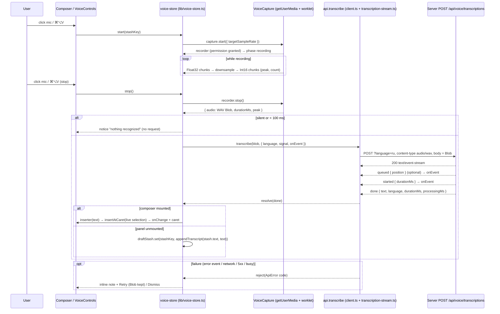

# Plan: voice-input, project `web`

Stage 3 (plan), role **client**. Binding for `/feature:implement web`. The contract is
`.claude/features/voice-input/contracts/` (owner: server); every shape, code and number below
comes from it. If this plan and the contract disagree, the contract wins. Nothing here is code.

## Now
1. Read `contracts/voice-api.ts` ("Client obligations"), `voice-events.ts`, `errors.ts`,
   `audio.ts`; then this plan top to bottom.
2. Implement steps 1–12 in order (each is bounded and leaves `pnpm --filter @otago/web test`
   and `pnpm lint` green).
3. After step 12 run the manual checklist (Chrome + Safari on `127.0.0.1:5173`) with the
   server from `projects/server/plan.md` running.

## Short
- Capability: `GET /api/voice` via `api.voiceInfo()` + `useVoiceInfo()`; mic, switcher and
  shortcut exist only when `available: true`.
- Capture: `getUserMedia` → `AudioContext` + `AudioWorklet` → downsample to 16 kHz Int16 on
  the fly → canonical 44-byte WAV `Blob` (`audio/wav`); no `MediaRecorder`, no compressed
  formats (the contract accepts only 16 kHz / mono / 16-bit PCM WAV).
- Upload: `api.transcribe(blob, { language, signal, onEvent })` = `POST
  /api/voice/transcriptions?language=` read with `readSse`; `done.text` is inserted at the
  live caret of the composer that started the recording (or into its `draftStash` entry).
- State: ONE voice session per tab in a pure reducer (`lib/voice.ts`) + a small store
  (`lib/voice-store.ts`, `useSyncExternalStore`, created in `main.tsx` like the question
  store); components stay thin (`VoiceControls.tsx`).
- UI: mic button (`aria-pressed`), elapsed time, `Auto / EN / RU` select persisted in
  `localStorage` `otago.voice.lang` (default = UI language), shortcut `⌘⌥V` / `Ctrl+Alt+V`
  (toggle), `Esc` cancels while recording.

---

## Decisions

Open questions of `feature.md` that the web owns, resolved here.

| # | Topic | Decision |
|---|---|---|
| W1 | Audio format | Client-side 16 kHz mono 16-bit PCM WAV (contract `audio.ts`). Captured with an `AudioWorkletNode` from a `MediaStreamAudioSourceNode` at the context's native rate (44.1/48 kHz), downsampled incrementally on the main thread to Int16 chunks; the WAV is assembled at stop. Memory ≈ 32 KB/s (1 h ≈ 115 MB), never the float32 source. `MediaRecorder` is not used (webm/mp4 would need server-side ffmpeg, which the contract rules out). |
| W2 | Worklet delivery | The worklet source is a string constant (`lib/voice-worklet-source.ts`) loaded through `URL.createObjectURL(new Blob([...], { type: 'text/javascript' }))`. No public asset, no Vite worker plumbing, works unchanged in the demo build. |
| W3 | Unsupported browser | Server `available: false` → mic, switcher and shortcut are **absent** (app as before). Server available but the browser cannot record (insecure context, no `getUserMedia`, no `AudioWorklet`) → mic **rendered disabled** with a `title` explaining why (`voice.insecure` / `voice.unsupported`); the shortcut is inert. Reason: the fix (open `127.0.0.1`, update the browser) is user-side and deserves a hint. |
| W4 | Shortcut | `⌘+Option+V` (macOS) / `Ctrl+Alt+V` (others): `(metaKey \|\| ctrlKey) && altKey && !shiftKey && code === 'KeyV'`. Matched on `code`, so Cyrillic layouts and macOS Option-characters (`√`) do not matter. VS Code uses the same chord for dictation. No collision with Ctrl/⌘+Z, Enter, Shift+Enter, ⌘+Shift+V (paste plain) or the macOS input-source chords. `Esc` cancels while recording. |
| W5 | One session per tab | At most one session (`recording`, `transcribing` or `failed`). While `recording`/`transcribing`, the mic of the **other** panel is disabled (`title` `voice.busyElsewhere`); the shortcut and `Esc` act on the active recording from any panel. Starting a new recording while a `failed` session is shown discards it (implicit dismiss). Rationale: one microphone, one upload, simplest state; a session list is a documented seam. |
| W6 | Insertion | `done.text` goes to the composer identified by the session's `stashKey` at the **live** caret (selection replaced), with one separating space on each side when the neighbouring character is not whitespace; caret lands after the text. Panel unmounted → appended to `draftStash` for that key (shown when the panel remounts). Nothing is auto-sent. |
| W7 | Silence / empty | Client applies the contract's silence rule before uploading (`peak < VOICE_SILENCE_PEAK` or `< VOICE_MIN_DURATION_MS`) → inline "nothing recognized", no request. `done.text === ''` and 400 `empty_audio` → the same notice. Not retryable. |
| W8 | Retry | Retryable failures (contract list) keep the `Blob`; the composer shows the error with **Retry** / **Dismiss**. Retry re-POSTs the same `Blob` and stays offered while the failed state is shown (the contract guarantees re-POST is always safe; `feature.md`'s "once" is the minimum). Non-retryable codes drop the audio and show only the error. |
| W9 | No length cap | No timer limit. Elapsed time is shown (`m:ss` / `h:mm:ss`). The only client-side refusal is `blob.size > limits.maxBytes` (same notice as 413 `audio_too_large`). |
| W10 | Tab hidden / track ended | `visibilitychange` → hidden, or the audio track's `ended` event (device unplugged) → the recording stops and what was captured is transcribed (feature edge case). |
| W11 | Capability refresh | `useVoiceInfo()` refetches on window focus (`refetchOnWindowFocus: true`, overriding the app default) and the store invalidates it on 503 `voice_unavailable`. A user who installs Whisper sees the mic after focusing the window or reloading. |
| W12 | Error surface | Errors and "nothing recognized" are **inline in the owning composer** (`voice-note` row, same look as `composer-file-errors`). If the owner is unmounted when a failure arrives, the session stays `failed` in the store (retry possible when the panel remounts) and a global `pushNotice` tells the user. |

---

## Target file layout

### New files
```
web/src/lib/voice.ts                    pure reducer + selectors + labels (session state machine)
web/src/lib/voice.test.ts
web/src/lib/voice-wav.ts                pure DSP/format: downsample, Int16 convert, peak, WAV encode, header parse
web/src/lib/voice-wav.test.ts
web/src/lib/voice-insert.ts             pure: insertAtCaret, appendTranscript
web/src/lib/voice-insert.test.ts
web/src/lib/voice-language.ts           pure: VOICE_LANG_KEY, resolveVoiceLanguage, isVoiceLanguage
web/src/lib/voice-language.test.ts
web/src/lib/voice-errors.ts             VOICE_ERROR_CODES, isVoiceRetryable, describeVoiceError (i18n)
web/src/lib/voice-errors.test.ts
web/src/lib/voice-capture.ts            browser capture adapter (getUserMedia + worklet) behind an interface
web/src/lib/voice-worklet-source.ts     the AudioWorkletProcessor source as a string
web/src/lib/voice-store.ts              createVoiceStore(deps), VoiceStoreContext, hooks
web/src/lib/voice-store.test.ts
web/src/api/transcription-stream.ts     parseTranscriptionEvent, readTranscription (SSE → events, watchdog)
web/src/api/transcription-stream.test.ts
web/src/components/chat/VoiceControls.tsx   mic button + language select + status + inline note
web/src/components/chat/VoiceControls.test.tsx (renderToStaticMarkup)
web/src/components/chat/useVoice.ts     per-panel glue: store ↔ composer (inserter, shortcut handlers)
```

### Changed files
```
web/src/api/types.ts          voice types (mirror of the contract), ErrorBody.code union
web/src/api/client.ts         api.voiceInfo, api.transcribe, TranscribeOptions, voice codes in isErrorCode
web/src/api/client.test.ts    tests for the two new calls
web/src/api/queries.ts        keys.voice, useVoiceInfo
web/src/lib/keyboard.ts (+test) KeyLike.code, isVoiceShortcut, shouldHandleVoiceShortcut, isCancelKey
web/src/components/chat/Composer.tsx    ComposerHandle.insert, voice slot, keydown wiring
web/src/components/chat/useComposer.ts  exposes insertText; registers the voice inserter
web/src/components/chat/ChatView.tsx, SideChatView.tsx   pass the voice props
web/src/main.tsx              create the voice store, provide VoiceStoreContext
web/src/i18n/locales/{en,ru}/chat.ts    chat.voice.* strings
web/src/styles/base.css       .voice-* classes (mic states, pulse, note row)
```

No generated files, no codegen command (the repo has none; `api/types.ts` is hand-mirrored).

---

## 1. Capability discovery

### Types (`web/src/api/types.ts`)
Mirror the contract verbatim, with a header comment naming
`.claude/features/voice-input/contracts`:
- `VoiceLanguage`, `VoiceUnavailableReason`, `VoiceUnavailable`, `VoiceAvailable`,
  `VoiceInfo`, `VoiceAudioFormat` (`voice-api.ts`, `audio.ts`).
- `TranscriptionQueuedEventData`, `TranscriptionStartedEventData`,
  `TranscriptionSegmentEventData`, `TranscriptionDoneEventData`,
  `TranscriptionErrorEventData`, `TranscriptionStreamEvent`, `TranscriptionResult`.
- `VoicePreStreamErrorCode`, `VoiceStreamErrorCode`, `VoiceErrorCode`,
  `VoiceUnavailableDetails`, `VoiceBusyDetails`, `UnsupportedAudioDetails`,
  `AudioTooLargeDetails`.
- `ErrorBody.code` union gains `VoiceErrorCode`.
- Reserved members (`segment`, `done.audio`, `keep`, `tree`, `streaming`) are mirrored as
  types but never produced or sent.

### Client (`web/src/api/client.ts`)
- `api.voiceInfo: () => request<VoiceInfo>('/voice')` (always 200).
- `ApiErrorCode` gains `VoiceErrorCode`; `isErrorCode` checks `VOICE_ERROR_CODES` imported
  from `lib/voice-errors.ts` (like `chat-files.ts`, that module imports nothing from
  `api/client.ts`).

### Query (`web/src/api/queries.ts`)
- `keys.voice = ['voice'] as const`.
- `useVoiceInfo()` = `useQuery({ queryKey: keys.voice, queryFn: api.voiceInfo, staleTime: 30_000,
  refetchOnWindowFocus: true, retry: false })`. Undefined while loading → treated as
  unavailable (mic absent until the answer arrives; no flash of a disabled control).
- Consumers read `data?.available === true` and `data.limits.maxBytes`,
  `data.audio.sampleRate` (the encoder targets this rate; default 16 000), `data.languages`
  (the select lists only languages the server offers, in the fixed order Auto, EN, RU).

### Mic visibility rule (pure, `lib/voice.ts` `micAvailability(info, support)`)
Returns `'hidden' | 'ok' | 'insecure' | 'unsupported'`:
- `info` not available → `hidden`;
- `support` (from `browserVoiceSupport()`, section 2) → `ok` / `insecure` / `unsupported`.

---

## 2. Browser recording (`lib/voice-capture.ts`, `lib/voice-wav.ts`, `lib/voice-worklet-source.ts`)

### Support detection (`browserVoiceSupport(win = window)`)
Pure over a `window`-like argument (testable):
- `!win.isSecureContext` → `'insecure'` (`127.0.0.1`/`localhost` are secure; a LAN `http://`
  host is not);
- missing `navigator.mediaDevices?.getUserMedia`, `AudioContext`/`webkitAudioContext`, or
  `AudioWorkletNode` → `'unsupported'`;
- else `'ok'`.

### Capture adapter interface (what the store depends on; the real one is DOM-only)
```
interface VoiceCapture {
  start(options: { targetSampleRate: number; onEnded(): void }): Promise<VoiceRecorder>;
}
interface VoiceRecorder {
  /** Stop and encode: resolves with the WAV + stats. */
  stop(): Promise<{ audio: Blob; durationMs: number; peak: number }>;
  /** Stop and drop everything captured. */
  cancel(): void;
}
```
(Shapes written as prose in the plan for the implementer; not code to copy blindly.)

### Real implementation (`createBrowserVoiceCapture()`)
- `getUserMedia({ audio: { channelCount: 1, echoCancellation: true, noiseSuppression: true,
  autoGainControl: true } })` → `new AudioContext()` (native rate; no `sampleRate` option,
  Safari is unreliable with it) → `audioWorklet.addModule(blobUrl)` (once per context;
  the blob URL is revoked afterwards) → `MediaStreamAudioSourceNode` →
  `AudioWorkletNode('otago-pcm')` → `context.destination` is NOT connected (no monitoring).
- The worklet batches 128-frame quanta into ~4 096-frame `Float32Array`s and
  `postMessage`s them (transferable). Main thread: `downsampler.push(chunk)` →
  `Int16Array` chunks appended to a list; running `peak` and `sampleCount`.
- `stop()`: disconnect, `track.stop()`, `context.close()`, flush the downsampler, build the
  WAV `Blob([header, ...chunks], { type: 'audio/wav' })`.
- `cancel()`: same teardown, chunks dropped.
- `track.onended` → `onEnded()` (the store stops the session, W10).
- Errors from `getUserMedia` are classified by `captureErrorKind(error)` (pure, in
  `voice-capture.ts`): `NotAllowedError`/`SecurityError` → `permission`;
  `NotFoundError`/`OverconstrainedError` → `no-device`; `NotReadableError`/`AbortError` →
  `device-busy`; anything else → `unknown`.

### Pure DSP/format (`lib/voice-wav.ts`, no DOM, reusable by the demo mock)
- Constants mirrored from `audio.ts`: `VOICE_SAMPLE_RATE = 16000`, `VOICE_CHANNELS = 1`,
  `VOICE_BITS = 16`, `VOICE_BYTES_PER_SECOND = 32_000`, `VOICE_SILENCE_PEAK = 328`,
  `VOICE_MIN_DURATION_MS = 100`, `VOICE_AUDIO_MIME_TYPE = 'audio/wav'`.
- `createDownsampler(inputRate, outputRate)`: stateful linear-interpolation resampler with
  a one-pole low-pass pre-filter; `push(Float32Array): Int16Array`, `flush(): Int16Array`.
  Identity fast path when the rates match. (Quality is sufficient for speech; a windowed
  sinc can replace it later behind the same interface.)
- `floatToInt16(sample)` (clamp, round), `peakOf(Int16Array, previous)`.
- `encodeWav(chunks: Int16Array[], sampleRate): Blob` — canonical 44-byte header (`RIFF`,
  `fmt ` 16 bytes, PCM = 1, mono, 16-bit, `data` size = total bytes, even by construction).
- `parseWavHeader(bytes: Uint8Array)`: returns `{ sampleRate, channels, bitsPerSample,
  audioFormat, dataBytes }` or a reason — used by tests and offered to the demo mock for its
  `invalid_audio` / `unsupported_audio_format` checks.
- `durationMsOf(dataBytes)` = `Math.round(dataBytes / 32)`, `isSilent(peak)`,
  `isTooShort(durationMs)`.

### Limits and cancel
- No duration cap (W9). Before upload: `blob.size > limits.maxBytes` → inline
  `voice.tooLarge` (not retryable), audio dropped.
- Cancel (`Esc` or the Cancel control while recording) → `recorder.cancel()`, state `idle`,
  draft untouched, nothing sent.

---

## 3. Upload, transcription and insertion

### `api.transcribe` (`web/src/api/client.ts`)
Signature as recommended by the contract:
`transcribe(audio: Blob, options: TranscribeOptions): Promise<TranscriptionResult>` with
`TranscribeOptions = { language: VoiceLanguage; signal?: AbortSignal; onEvent?: (event:
TranscriptionStreamEvent) => void }` (exported type).
1. `fetch('/api/voice/transcriptions?language=' + language, { method: 'POST', body: audio,
   headers: { 'content-type': 'audio/wav', accept: 'text/event-stream' }, signal,
   cache: 'no-store' })`. `Content-Length` is set by the browser from the `Blob`.
2. `!res.ok` → `throw await errorOf(res)` (JSON `ErrorBody` → `ApiError` with the voice
   code and `details`).
3. `200` but `content-type` without `text/event-stream` or no body → `ApiError(0,
   'Transcription stream unavailable', 'transcription_failed')`.
4. `readTranscription(res.body, { onEvent, signal })` (`api/transcription-stream.ts`)
   resolves with the `done` data or rejects.

### `api/transcription-stream.ts`
- `parseTranscriptionEvent(sse): TranscriptionStreamEvent | null` — same style as
  `parseQuestionEvent`: unknown names → `null`; known names with bad JSON/shape → throw
  `VoiceProtocolError`. `segment` is parsed but ignored by the reader (v1).
- `readTranscription(body, { onEvent, watchdogMs = 45_000 })`: iterates `readSse(body,
  { onBytes: arm })`; the watchdog is armed when the response arrived (not at request
  start: a large upload may take a while and yields no bytes); every event is forwarded to
  `onEvent`; `done` resolves; `error` rejects with `ApiError(0, data.error, data.code)`;
  stream end without a terminal event or a watchdog fire → `ApiError(0, …,
  'transcription_failed')`; abort → the `AbortError` propagates.
- Exported constants: `TRANSCRIPTION_WATCHDOG_MS = 3 * SSE_PING_INTERVAL_MS` (reuse the
  constant from `api/question-events.ts`).

### Error → notice mapping (`lib/voice-errors.ts`, `describeVoiceError(error)`)
Returns `{ message, retryable, kind: 'error' | 'empty' }` from `ApiError.code` / status:

| Source | Code / status | i18n key (`chat:voice.*`) | retryable |
|---|---|---|---|
| pre-stream 400 | `empty_audio` | `nothingRecognized` (kind `empty`) | no |
| pre-stream 503 | `voice_unavailable` | `unavailable` (+ invalidate `keys.voice`) | no |
| pre-stream 503 | `voice_busy` | `busy` (uses `details.waiting`/`maxWaiting` when present) | yes |
| pre-stream 400/415 | `invalid_audio`, `unsupported_audio_format` | `badAudio` | no |
| pre-stream 413 | `audio_too_large` | `tooLarge` | no |
| in-stream | `transcription_failed` | `failed` | yes |
| in-stream | `transcription_timeout` | `timeout` | yes |
| in-stream | `server_shutdown` | `serverRestarted` | yes |
| other | network error (`TypeError`), 5xx, `AbortError` is never shown | `network` | yes |

Capture errors (`captureErrorKind`) map to `permissionDenied`, `noDevice`, `deviceBusy`,
`captureFailed` — never retryable (the mic stays enabled, the user clicks again).

### Insertion (`lib/voice-insert.ts`)
- `insertAtCaret(text, start, end, transcript): { text, caret }` — replaces `[start, end)`;
  adds a single space before when `text[start-1]` exists and is not whitespace, and after
  when `text[end]` exists and is not whitespace; `caret` = index right after the inserted
  transcript (before the trailing separator). Transcript is trimmed first; empty → no-op.
- `appendTranscript(draftText, transcript)` = `insertAtCaret(draftText, len, len,
  transcript).text` (stash fallback).
- Both operate on UTF-16 indices as the textarea does (no grapheme cutting is involved).

### Delivery (store ↔ composer)
- `useComposer` registers an inserter for its `stashKey`:
  `voiceStore.attachInserter(stashKey, (transcript) => insertText(transcript))`, released on
  unmount (declared AFTER the existing stash-writing effect, so its cleanup runs after the
  stash was written).
- `insertText` (new in `ComposerState`) calls `ComposerHandle.insert(transcript)`: the
  `Composer` reads the live `selectionStart`/`selectionEnd` of its textarea (also while
  `disabled`), computes `insertAtCaret`, calls `onChange(next.text)` and schedules the caret
  (`wantCaret` ref consumed by the existing `useLayoutEffect`, like `focusEnd`). When the
  textarea ref is missing it falls back to `appendTranscript` on the current draft.
- On `done`: `inserter ?? draftStash` — the store calls the registered inserter, else
  `draftStash.set(key, { text: appendTranscript(stash?.text ?? '', text), files:
  stash?.files ?? [] })`.
- The composer being `locked` does not block insertion (the draft survives in the textarea
  / stash; it is sent later by the user).

---

## 4. UI

### Placement (`Composer.tsx`)
New optional prop `voice: VoiceSlot | null` (the hooks compute it; `null` = feature absent).
Rendered inside `.composer-bar` right after the Attach button and before the model picks:
`[Attach] [🎤 mic] [Auto ▾] … models … [spacer] [Send]`. The inline note row
(`.voice-note`, errors / "nothing recognized" / Retry / Dismiss) renders above the bar,
next to `ComposerFiles` errors.

### `VoiceControls.tsx` (thin, props only)
- Mic `<button className="voice-mic" aria-pressed={recording} aria-label=… title=…>`;
  label/title by state: `voice.start` (+ shortcut hint), `voice.stop`, `voice.transcribing`,
  `voice.busyElsewhere`, `voice.insecure`, `voice.unsupported`. Disabled when the panel is
  `locked` (except while this panel records: Stop stays enabled), when another panel's
  session is active, during `transcribing`, or when support ≠ `ok`.
- Status chip (`role="status"`, `aria-live="polite"`): recording → pulsing dot + elapsed
  (`formatElapsed`, ticked by a 1 s interval inside this component only); transcribing →
  `voice.transcribing` / `voice.queued` (`{{position}}`) / `voice.transcribingOf`
  (`{{duration}}` from `started.durationMs`) + a Cancel icon button (aborts the fetch).
- Language `<select className="voice-lang">` (same `model-pick` styling): `Auto`, `EN`,
  `RU` (labels from `voice.lang.*`; order fixed; filtered by `info.languages`). Disabled
  while recording/transcribing (the value is read at upload time; changing it mid-session
  would be ambiguous).
- Inline note: `describeVoiceError` text, `Retry` (retryable only) and `Dismiss`.

### Language persistence (`lib/voice-language.ts`)
- `VOICE_LANG_KEY = 'otago.voice.lang'`; `isVoiceLanguage(value)`;
  `resolveVoiceLanguage(stored, uiLanguage: Language): VoiceLanguage` → valid stored value,
  else the UI language (`i18n.resolvedLanguage`, `en`/`ru`).
- The store owns the current value (`state.language`), reads it at creation
  (`safeStorage.get`), writes on change (`safeStorage.set`), and follows a `storage` event
  (cross-tab), like `use-theme.ts`. Both panels show the same value.

### Keyboard (`lib/keyboard.ts`)
- `KeyLike.code?: string` added.
- `isVoiceShortcut(e)`: `(e.metaKey || e.ctrlKey) && e.altKey && !e.shiftKey && e.code === 'KeyV'`.
- `shouldHandleVoiceShortcut(e)`: `isVoiceShortcut(e) && !e.repeat && !e.defaultPrevented && !e.isComposing`.
- `isCancelKey(e)`: `e.key === 'Escape'` without modifiers.
- Wiring: the composer textarea `onKeyDown` (before the Enter check) → shortcut: idle →
  start for this panel; recording → stop (any owner); `Esc` while this tab records →
  cancel; both `preventDefault`. A window-level listener in `useVoice` (owner panel only)
  handles the shortcut/`Esc` while focus is outside the textarea; it never starts a
  recording.
- `shouldHandleTreeUndo` is untouched (Alt excluded there already, so no overlap).

### Styling (`styles/base.css`)
`.voice-mic`, `.voice-mic[aria-pressed="true"]` (accent + `voice-pulse` keyframes, reuse
the `attachment-pulse` rhythm), `.voice-status`, `.voice-lang`, `.voice-note` (reuse the
`composer-file-errors` palette). Icons: inline SVG mic in `VoiceControls.tsx`.

---

## 5. State: pure reducer + store

### `lib/voice.ts` (pure, tested)
```
VoiceSession =
  | { phase: 'requesting'; stashKey }                             // waiting for getUserMedia
  | { phase: 'recording';  stashKey; startedAt }
  | { phase: 'stopping';   stashKey }                             // encoding the WAV
  | { phase: 'transcribing'; stashKey; audio: Blob; durationMs; language;
      progress: { kind: 'uploading' } | { kind: 'queued'; position } | { kind: 'started'; durationMs } }
  | { phase: 'failed';     stashKey; audio: Blob | null; durationMs; language; error: unknown }
VoiceState = { session: VoiceSession | null; language: VoiceLanguage;
               notice: { stashKey; kind: 'empty' } | null }
```
Actions: `start`, `permissionGranted(startedAt)`, `captureFailed(error)`, `stop`,
`encoded(audio, durationMs, peak)` (→ `transcribing`, or `notice: empty` + `null` when
silent/short, or `failed` non-retryable when over `maxBytes`), `cancel`,
`progress(event)` (`queued`/`started`), `done(text)` (→ `session: null`; insertion is an
effect), `fail(error)` (→ `failed` with audio when retryable, else `audio: null`),
`retry` (→ `transcribing`), `dismiss`, `setLanguage`, `clearNotice`.
Selectors: `selectSessionFor(stashKey)`, `selectMicState(stashKey, locked, availability)`
→ `{ mode: 'start' | 'stop' | 'disabled', reason? }`, `isActive(state)`,
`formatElapsed(ms)`, `micAvailability(...)`. The reducer returns the same object when
nothing changes. `segment` events are accepted and ignored (streaming seam: a future
`preview` field).

### `lib/voice-store.ts`
`createVoiceStore({ api: Pick<typeof api, 'voiceInfo' | 'transcribe'>, capture: VoiceCapture,
stash: DraftStash, storage: KeyValueStore, now, onUnavailable?: () => void, doc?, win? })`:
- `getState`, `subscribe`, `useVoiceStore()` (context), `useVoiceSelector(selector,
  equals)` via `useSyncExternalStore` (publishes synchronously; the state changes a few
  times per session, no rAF batching needed).
- Effects: `start(stashKey, { targetSampleRate, maxBytes })` → `capture.start`; `stop()` →
  `recorder.stop()` → `encoded` → `api.transcribe(audio, { language, signal, onEvent })` →
  `done`/`fail`; `cancel()`; `retry()`; `dismiss()`; `setLanguage()`;
  `attachInserter(stashKey, fn): release`.
- Listeners while recording: `visibilitychange` (hidden → `stop()`), recorder `onEnded`
  → `stop()`. `AbortController` per transcription; `cancel()` in `transcribing` aborts it.
- On 503 `voice_unavailable` → `onUnavailable()` (main.tsx passes
  `() => queryClient.invalidateQueries({ queryKey: keys.voice })`).
- Provided from `main.tsx` through `VoiceStoreContext` (created once, outside React, next to
  the question store).

### Hooks (`components/chat/useVoice.ts`)
`useVoice({ stashKey, locked, insertText })` → `VoiceSlot | null` for `Composer`: reads
`useVoiceInfo()`, `browserVoiceSupport()` (memoised once), the store selectors; returns
callbacks `onToggle`, `onCancel`, `onRetry`, `onDismiss`, `onLanguageChange`, and the
textarea `onKeyDown` helper `handleVoiceKey(event): boolean` (true when consumed).
`ChatView`/`SideChatView` call it next to `useComposer` and pass the slot down.

---

## 6. i18n (`web/src/i18n/locales/{en,ru}/chat.ts`, namespace `chat`, key `voice`)

### Controls and status
`start` ("Dictate ({{shortcut}})"), `stop` ("Stop dictation"), `cancel`, `retry`, `dismiss`,
`recording` ("Recording {{elapsed}}"), `transcribing` ("Transcribing…"),
`transcribingOf` ("Transcribing {{duration}} of audio…"), `queued` ("Waiting for another
transcription ({{position}} ahead)…"), `shortcutMac` ("⌘⌥V"), `shortcutOther` ("Ctrl+Alt+V").

### Language switcher
`lang.legend` ("Recognition language"), `lang.auto` ("Auto"), `lang.en` ("EN"), `lang.ru`
("RU"), `lang.title.auto` ("Detect automatically"), `lang.title.en`, `lang.title.ru`.

### Notices (errors / empty)
`nothingRecognized`, `permissionDenied`, `noDevice`, `deviceBusy`, `captureFailed`,
`insecure` ("Dictation needs a secure page: open the app via 127.0.0.1 or localhost."),
`unsupported`, `busyElsewhere` ("Recording in the other chat"), `unavailable`, `busy`,
`badAudio`, `tooLarge`, `failed`, `timeout`, `serverRestarted`, `network`.

Russian texts mirror every key (`satisfies Messages<typeof en>` enforces completeness).
`i18n.test.ts` gets one assertion that `voice.*` resolves in both languages.

---

## 7. Tests (`pnpm --filter @otago/web test`, Node environment, no DOM)

### Pure modules
- `lib/voice-wav.test.ts`: downsampler (48k→16k length and a 1 kHz sine survives; identity
  path; `flush`), `floatToInt16` clamping, `encodeWav` header bytes (`RIFF`/`WAVE`/`fmt `
  = 1/1/16000/16/32000/2, `data` size), `parseWavHeader` round-trip, `isSilent`,
  `durationMsOf`.
- `lib/voice.test.ts`: every transition above, silence/short/over-max branches, `failed`
  retryable vs not, `selectMicState` for owner/other panel/locked/unsupported,
  `formatElapsed` (`0:07`, `12:34`, `1:02:03`), same-object-when-unchanged.
- `lib/voice-insert.test.ts`: caret in the middle/at the ends, selection replaced, spacing
  rules (no double spaces, newline neighbours), empty transcript no-op, `appendTranscript`.
- `lib/voice-language.test.ts`, `lib/voice-errors.test.ts` (every code → key + retryable),
  `lib/keyboard.test.ts` (shortcut on `code`, Shift/repeat/composing rejected, no overlap
  with `isUndoShortcut`).

### Client and stream
- `api/transcription-stream.test.ts`: `ReadableStream` bodies with `retry:`, `id:`,
  `: ping`, `queued`→`started`→`done`; `error` event rejects with the code; unknown event
  ignored; `segment` ignored; end without terminal → `transcription_failed`; watchdog
  (fake timers) → `transcription_failed`; abort → `AbortError`.
- `api/client.test.ts`: `voiceInfo` URL; `transcribe` sends `POST`, `content-type:
  audio/wav`, `?language=ru`, the `Blob` body and the signal; non-2xx JSON → `ApiError`
  with a voice code and `details`.

### Store and components
- `lib/voice-store.test.ts`: fake `VoiceCapture` (controllable `stop()` result) + fake api
  (deferred promise): start→stop→transcribe→done inserts through the attached inserter;
  no inserter → stash append; silent → notice, no api call; failure keeps the `Blob` and
  `retry` re-POSTs the same `Blob`; `cancel` while transcribing aborts the signal;
  `voice_unavailable` calls `onUnavailable`; language persists via the storage fake.
- `components/chat/VoiceControls.test.tsx` (`renderToStaticMarkup`): idle/recording/
  transcribing/failed markup, `aria-pressed`, disabled reasons in `title`, options of the
  select, English strings.
- Lint: `pnpm lint` (Biome + `tsc --noEmit`); format with `pnpm format` only.

### Manual checklist (after step 12)
Chrome + Safari on `127.0.0.1:5173`: permission prompt, dictation ru/en/auto, insertion at
caret while typing, `Esc` cancel, shortcut from the textarea and from the graph, side chat,
locked composer insertion, server stopped mid-transcription → Retry works after restart,
10-minute recording completes.

---

## 8. Ordered implementation steps

| # | Step | Files | Est. |
|---|---|---|---|
| 1 | Types + error codes: mirror the contract in `api/types.ts`; `lib/voice-errors.ts` with `VOICE_ERROR_CODES`; extend `ApiErrorCode`/`isErrorCode` | `api/types.ts`, `lib/voice-errors.ts`, `api/client.ts` | 45 min |
| 2 | `api/transcription-stream.ts` + tests (parser, reader, watchdog) | `api/transcription-stream.ts`, `.test.ts` | 1.5 h |
| 3 | `api.voiceInfo`, `api.transcribe`, `TranscribeOptions`; `keys.voice`, `useVoiceInfo`; client tests | `api/client.ts`, `api/queries.ts`, `api/client.test.ts` | 1 h |
| 4 | Pure DSP/format `lib/voice-wav.ts` + tests | `lib/voice-wav.ts`, `.test.ts` | 2 h |
| 5 | Pure reducer/selectors `lib/voice.ts`, `lib/voice-insert.ts`, `lib/voice-language.ts` + tests | those + `.test.ts` | 2.5 h |
| 6 | Keyboard predicates + tests | `lib/keyboard.ts`, `lib/keyboard.test.ts` | 30 min |
| 7 | Capture adapter: interface, `browserVoiceSupport`, `captureErrorKind` (tested), worklet source, real `createBrowserVoiceCapture` (manual) | `lib/voice-capture.ts`, `lib/voice-worklet-source.ts` | 2.5 h |
| 8 | Store `lib/voice-store.ts` + tests (fake capture/api/stash/storage) | `lib/voice-store.ts`, `.test.ts`, `main.tsx` | 3 h |
| 9 | i18n strings en + ru, `i18n.test.ts` assertion | `i18n/locales/{en,ru}/chat.ts`, `i18n/i18n.test.ts` | 45 min |
| 10 | `Composer.tsx`: `ComposerHandle.insert`, `wantCaret`, `voice` slot, keydown wiring; `useComposer`: `insertText`, inserter registration | `components/chat/Composer.tsx`, `useComposer.ts` | 1.5 h |
| 11 | `VoiceControls.tsx` + `useVoice.ts` + CSS + wiring in `ChatView`/`SideChatView`; component test | `components/chat/VoiceControls.tsx`, `useVoice.ts`, `ChatView.tsx`, `SideChatView.tsx`, `styles/base.css` | 3 h |
| 12 | `pnpm lint`, `pnpm test`, manual checklist (Chrome + Safari), `CLAUDE.md` web section (one paragraph: voice session, files, shortcut) | repo root | 1.5 h |

Total ≈ 2.5–3 working days. Steps 1–6 are independent of the DOM and can be verified with
tests alone; 7 is the only step that needs a browser; 8 depends on 3, 4, 5, 7 (interfaces
only); 10–11 depend on everything before.

---

## 9. New exports of `web/src/api/client.ts` (the demo shim must mirror them)

### Top-level exports (checked by `exportsComplete`)
- `type TranscribeOptions` (`{ language: VoiceLanguage; signal?: AbortSignal; onEvent?:
  (event: TranscriptionStreamEvent) => void }`).
- (`ApiErrorCode`, `ApiError`, `isApiError`, `buildQuestionBody`, URL helpers: unchanged
  names, `ApiErrorCode` widened by `VoiceErrorCode`.)

### New members of `api` (the demo's `api: typeof Real.api` must implement them)
- `api.voiceInfo(): Promise<VoiceInfo>`.
- `api.transcribe(audio: Blob, options: TranscribeOptions): Promise<TranscriptionResult>` —
  resolves with the `done` data, rejects with `ApiError` (pre-stream status, or status `0`
  with an in-stream code) or an `AbortError`.

### Not in `client.ts` on purpose (so the shim needs nothing else)
- SSE reading lives in `api/transcription-stream.ts`; codes in `lib/voice-errors.ts`; DSP
  and WAV parsing in `lib/voice-wav.ts` (importable by `demo/src/mock/` for its
  `invalid_audio` / `unsupported_audio_format` / silence checks, like `node-names.ts`).

---

## 10. Contract gaps / open questions for the server

1. **`Retry-After` is not reachable through `ApiError`** (`errorOf` reads only the JSON
   body). The web shows `voice.busy` with `details.waiting`/`maxWaiting` and no countdown.
   No change requested; noted so nobody expects the header to be used.
2. **Watchdog start.** The contract's "no bytes for 45 s ⇒ failure" is applied from the
   moment the 200 response arrives. The upload phase itself has no client timeout (a long
   WAV over loopback is fast; Cancel is the escape). If the server ever wanted a client
   upload timeout, the contract should say so.
3. **`VoiceAvailable.audio.sampleRate`** is typed as the literal `16000`. The encoder reads
   the value anyway (default 16 000) so a future server could lower/raise it without a web
   change; channels/bits stay fixed. Confirm this is the intended seam or keep it literal.
4. **`done.language` for `auto`** may be any ISO code; v1 does not surface it. Optional
   later: a small "detected: uk" hint. No contract change needed.
5. **Silence rule duplication.** The web applies `VOICE_SILENCE_PEAK`/`VOICE_MIN_DURATION_MS`
   before uploading (allowed by the contract). If the server ever changes the threshold,
   publishing it in `GET /api/voice` (`limits.silencePeak`) would keep both in sync; not
   required for v1.

Nothing blocks implementation; the contract covers every shape the web needs.

---

## Sequence: record → upload → transcript → draft



---

## Future seams (do not implement)
- **Streaming partials**: `segment` events are parsed and ignored; the reducer can gain a
  `preview: string` on the `transcribing` session and `VoiceControls` a preview line without
  touching `useComposer`/insertion (`done.text` always replaces the preview).
- **Save the audio into the node**: the session keeps the `Blob` until insertion; adding it
  to the composer's files is `addFiles([new File([blob], 'dictation.wav')])` once the
  server accepts `.wav` in `MESSAGE_FILE_EXTENSIONS` (and the `keep` query param exists).
- **Several sessions per tab**: `VoiceState.session` becomes a map by `stashKey`; selectors
  already take `stashKey`.
- **Resampler quality**: `createDownsampler` is the single place to swap in a windowed sinc.

## Next
Open `web/src/api/types.ts` and add the header line referencing
`.claude/features/voice-input/contracts` to the module comment (step 1 starts there).
